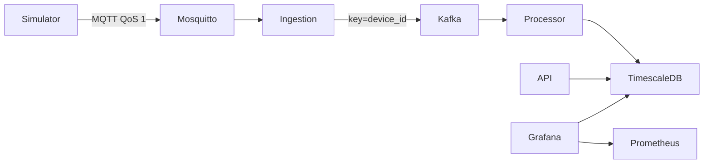

# Архитектура

Тема: «Разработка распределённой системы сбора, обработки и мониторинга
телеметрии электротехнических устройств с использованием Go и микросервисной архитектуры».

Согласовано: три серверных Go-сервиса, отдельный эмулятор, MQTT, Kafka,
PostgreSQL/TimescaleDB, Prometheus/Grafana. Redis вводится только по результатам измерений.

## Этап 1: вертикальный срез

Работают регистрация устройств, валидация MQTT, карантин некорректных сообщений,
Kafka, идемпотентная запись, последние значения и история с курсорами.
Обработка последовательная, одна транзакция на сообщение. Это контрольная
базовая реализация для последующего сравнения с пакетной записью.

Ingestion подтверждает входящее MQTT-сообщение после Kafka ACK. Processor
подтверждает Kafka offset после commit БД. Дубликаты ключа
`(device_id, message_id)` не создают повторную запись и не обновляют last_seen.
Изменение содержимого под тем же ключом попадает в карантин. Повторная
публикация в карантин при отказе допустима; потребитель карантина пока отсутствует.

`received_at` фиксируется на входе ingestion. Последнее измерение выбирается по
`(timestamp, message_id)`, last_seen — по максимальному received_at уникальных сообщений.
Для latest отдельно хранится время получения именно выбранного измерения.
Ключи дедупликации пока не удаляются. Политика retention будет введена вместе
с окном повторной доставки; автоматически удалять ключи раньше него нельзя.

## Границы гарантий

Один broker Kafka, один MQTT broker и одна БД предназначены для локального
стенда. Это не конфигурация высокой доступности. Kafka `acks=all` с одной
репликой не обеспечивает сохранность при потере диска. MQTT PUBACK генератору
не означает сохранение в БД. Mosquitto persistence периодическая; аварийное
завершение хоста может потерять недавно подтверждённые брокером сообщения.
Гарантия идемпотентного эффекта действует для сообщений, дошедших до Kafka,
при сохранности Kafka/БД и повторной доставке в пределах хранения Kafka.

Ограниченная очередь Kafka reader (32 записи); MQTT callback выполняется
последовательно. Медленная запись вызывает backpressure, ограниченные очереди
брокера могут переполниться. Для длительных отказов нужны испытания и
дополнительный протокол подтверждения результата устройству либо локальный outbox.

## Следующие этапы

1. Пороги, гистерезис, состояния аварий и определение offline с учётом lag.
2. Минутные/часовые/суточные continuous aggregates, retention, REST series.
3. Prometheus и Grafana с готовыми dashboards и метриками Kafka/БД.
4. Пакетная запись, обработчики по партициям, shared subscriptions ingestion.
5. Сценарии аварий и отдельные MQTT-соединения устройств в эмуляторе.
6. Испытания 100 / 1 000 / 10 000 устройств, исследование предела и 50 000 msg/s.

Результаты нагрузки пока отсутствуют. Метрика processor_commit_latency_seconds
измеряет receipt→DB commit (публикация метрики после offset commit); она не заменяет
полный end-to-end замер генератор→видимость через API.
